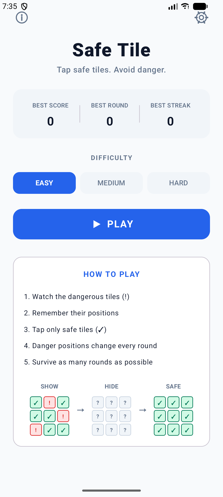
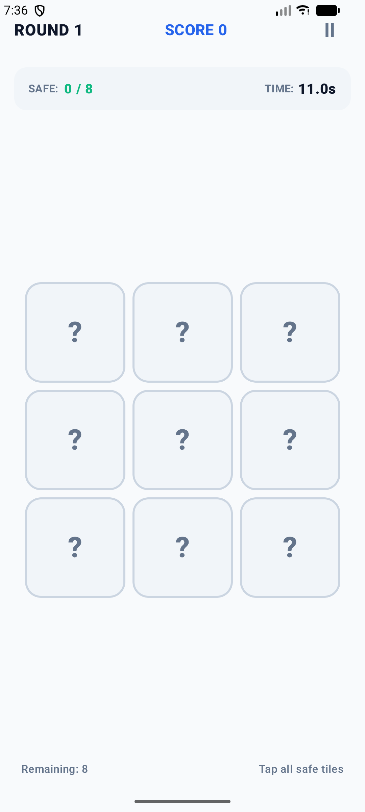

# Safe Tile 🟩⚠️

A sleek, fast-paced Android memory and focus puzzle game built natively with **Kotlin**, **Jetpack Compose**, and **Material 3**.

[](https://developer.android.com/)
[-brightgreen.svg)](https://developer.android.com/)
[](https://developer.android.com/)
[](https://kotlinlang.org/)
[](https://developer.android.com/jetpack/compose)

---

## 🎮 Game Overview

**Safe Tile** tests your memory, recall speed, and focus under pressure!

In every round:
1. **Memorize Phase:** A grid of tiles is briefly revealed. Observe and remember which tiles are marked as **Danger (!)** and which are **Safe (✓)**.
2. **Play Phase:** All tiles flip back to hidden. Your mission is to tap **only the safe tiles** before time runs out!
3. **Adaptive Escalation:** Complete a round and the danger tiles change positions, grid dimensions scale up, and time constraints tighten. One wrong tap on a danger tile or running out of time ends the run!

---

## ✨ Key Features

- 🧠 **Dynamic Pattern Memory Gameplay**
  - Instant memory challenge with real-time feedback.
  - Position shifting for danger tiles between every single round to prevent muscle memory reliance.

- ⚙️ **Three Tailored Difficulty Levels**
  - **Easy:** 3x3 scaling up to 5x5 grids with generous memorize/round timers.
  - **Medium:** 4x4 scaling up to 6x6 grids for a balanced challenge.
  - **Hard:** 5x5 scaling up to 7x7 grids with aggressive timers for expert players.

- 📈 **Scoring, Streaks & Speed Bonuses**
  - Score multipliers based on round depth, consecutive error-free streak, and remaining round time.
  - Tracks **Perfect Rounds**, **Best Streaks**, **Highest Score**, and **Rounds Survived**.

- 🎨 **Modern Design & Customization**
  - Full **Material 3 Design System** with dynamic dark and light mode support.
  - Edge-to-edge layout integration (`enableEdgeToEdge()`).
  - Accessibility toggles including **Reduced Motion Mode** for simplified animations.

- 🔊 **Rich Audio & Haptics**
  - Custom synthesized audio feedback for safe taps, danger hits, round transitions, and ticking clock countdowns.
  - Tactile haptic feedback for enhanced game interaction.

- 📊 **Persistent Player Statistics**
  - Real-time persistence using **Jetpack DataStore Preferences** to save high scores and statistics across sessions.

---

## 📸 Screenshots

| Home & How to Play | Gameplay Grid | Game Over & Stats |
| :---: | :---: | :---: |
|  |  | High scores, stats & difficulty selection |

---

## 🛠️ Architecture & Tech Stack

Safe Tile is constructed following modern Android development practices and recommended architecture patterns:

- **UI Layer:** [Jetpack Compose](https://developer.android.com/jetpack/compose) declarative UI with Material 3 UI components and dynamic layout sizing.
- **Architecture Pattern:** MVVM (Model-View-ViewModel) with Unidirectional Data Flow (UDF) powered by `StateFlow`.
- **Navigation:** [Jetpack Compose Navigation](https://developer.android.com/jetpack/compose/navigation) handling smooth transitions between Splash, Home, Game, Results, Settings, and About screens.
- **State Management:** Monotonic Coroutine-backed timers for smooth 30fps countdowns unaffected by system clock shifts.
- **Persistence:** [Jetpack DataStore Preferences](https://developer.android.com/topic/libraries/architecture/datastore) for asynchronous key-value configuration and high-score storage.
- **Dependency Management:** Gradle Version Catalogs (`libs.versions.toml`).

---

## 📂 Project Structure

```
SafeTile/
├── app/
│   ├── src/
│   │   ├── main/
│   │   │   ├── java/com/example/safetile/
│   │   │   │   ├── data/            # DataStore preferences & user settings
│   │   │   │   ├── engine/          # Sound, Haptics, Score & Round Generation logic
│   │   │   │   ├── model/           # Data models (Difficulty, TileData, GameState, etc.)
│   │   │   │   ├── ui/
│   │   │   │   │   ├── components/  # TileView, TileBoard, PauseDialog, Custom Icons
│   │   │   │   │   ├── navigation/  # NavGraph and Screen definitions
│   │   │   │   │   ├── screens/     # HomeScreen, GameScreen, ResultScreen, SettingsScreen, etc.
│   │   │   │   │   └── theme/       # M3 Color, Type, and Theme definitions
│   │   │   │   └── viewmodel/       # SafeTileViewModel & GameUiState
│   │   │   └── AndroidManifest.xml
│   │   └── test/                    # Unit tests for game logic & score calculation
│   └── build.gradle.kts
├── gradle/libs.versions.toml        # Version Catalog
├── build.gradle.kts
└── README.md
```

---

## 🚀 Getting Started

### Prerequisites

- **Android Studio:** Ladybug (2024.2.1) or newer recommended.
- **JDK:** Version 17 or higher.
- **Android SDK:** Target SDK 37, Minimum SDK 26 (Android 8.0 Oreo).

### Build and Run

1. Clone the repository:
   ```bash
   git clone https://github.com/abdullah-ateeq/Safe-Tile.git
   cd Safe-Tile
   ```
2. Open the project in **Android Studio**.
3. Let Gradle sync dependencies.
4. Select an Android Emulator or connected physical device running Android 8.0+.
5. Click **Run** (`Shift + F10`).

---

## 🧪 Testing

The repository contains unit tests covering round generation, danger placement non-repetition, difficulty configurations, and score calculations:

```bash
./gradlew test
```

---

## 📜 License

This project is licensed under the MIT License - see the [LICENSE](LICENSE) file for details.
